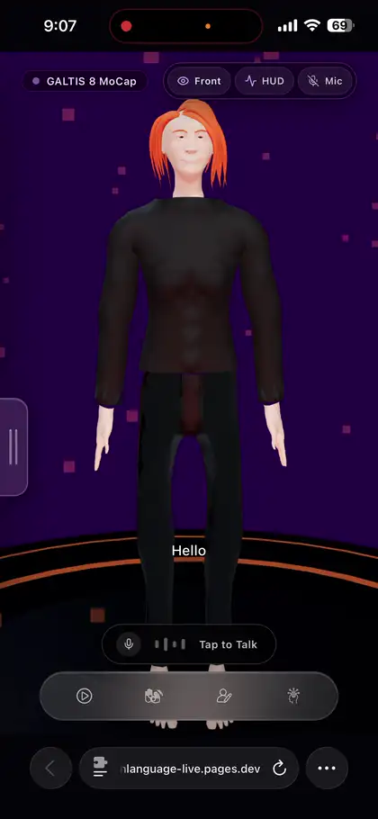

# SignBridge — 3D ASL Sign Language Companion


<p align="center">
  
</p>


> **SignBridge** is a real-time, browser-based 3D American Sign Language (ASL) companion web application powered by **React 19**, **Three.js**, **Tailwind CSS v4**, and authentic **StudioGalt Motion Capture** skeletal animations.

---

## System Overview & Purpose

SignBridge bridges auditory and visual communication by converting speech, text, and interactive dictionary selections into high-fidelity 3D sign language gestures performed by the stylized digital human avatar **Galtis**.

### Core Capabilities
1. **Real-time 3D Sign Playback**: Executes authentic motion capture recordings and procedural hand keyposes directly in the browser using WebGL.
2. **Interactive Half-Screen Dictionary**: A mobile-native drawer where users search and tap signs, while the 3D avatar in the upper half immediately performs the word in real time.
3. **Avatar Skin System**: Supports switching between the **Full Body Rig** (Primary avatar) and **Mesh + Hair** (Secondary skin) with zero animation interruption.
4. **Voice-to-Sign Engine**: Real-time microphone listening via Web Speech API with automatic tokenization, dictionary matching, and fingerspelling fallback.
5. **MoCap Telemetry HUD**: Real-time bone Euler rotations, quaternions, and FACS facial blendshape inspection.

---

---

## Detailed Component & System Architecture

### A. The 3D Engine (`src/components/Stage3D.tsx`)
- **Three.js Scene**: Renders the character inside a deep purple studio gradient (`#26004d`) with soft directional lighting, rim lights, and an ambient ring platform.
- **Camera View Modes**:
  - `front`: Standard eye-level framing showing head, torso, and hands.
  - `hands_closeup`: Zoomed-in perspective focused on finger and wrist articulations.
  - `upper_body`: Mid-torso framing optimized for sign visibility.
  - `stage_orbit`: Full stage view showing ground rings and atmospheric mist.
- **Animation Execution Loop**:
  - Taps into `requestAnimationFrame` to update `THREE.AnimationMixer` using clock delta.
  - Computes active bone coordinates (Euler degrees and quaternions) on every frame and emits them to `onCoordinatesUpdate` for HUD telemetry.

### B. The Galtis Avatar Controller (`src/components/GaltisOriginalAvatar.ts`)
- **Model Sources**:
  - `'full_mesh'`: Loads `/models/galtis_mesh.fbx` (Primary avatar). Features complete skeletal hierarchy and 73 facial blendshapes.
  - `'hello'`: Loads `/models/galtis_hello.fbx` (Secondary skin). Features styled hair strands and studio suit.
- **MoCap Track Synthesis**:
  - Parses JSON keyframe tracks from `/animations/<word>.json`.
  - Maps StudioGalt bone names to FBX bone targets (`Hips`, `Spine`, `LeftShoulder`, `LeftArm`, `LeftForeArm`, `LeftHand`, `RightArm`, finger joints, etc.).
  - Converts Euler rotation arrays into `THREE.QuaternionKeyframeTrack` and positions into `THREE.VectorKeyframeTrack`.
  - Creates a `THREE.AnimationClip` and executes it with `AnimationMixer.clipAction()`.
- **Idle Rest Pose**: Plays a subtle, organic breathing rest loop (`/animations/rest_pose.json`) when no sign is active.
- **Blendshape Animation**: Drives facial expressions (smiles, brow raises, furrows) via mesh `morphTargetInfluences`.

### C. The Half-Screen Bottom Drawer (`src/components/BottomHalfDrawer.tsx`)
- **Layout**: Takes `h-[48%]` of the mobile container with rounded top corners (`rounded-t-[32px]`) and silver-slate aesthetic (`#9d9ba9`).
- **Top Controls**: Includes "Cancel" and "Done" buttons at the top of the purple screen to dismiss the drawer and return to `'play'`.
- **Modes**:
  1. **Dictionary Mode**: Features a prominent `Search ASL Dictionary...` search input and a scrollable word list. Clicking any word immediately commands the avatar in the top half to sign that word in real time.
  2. **Skins Mode**: Displays skin cards for **Full Body Rig** (Primary) and **Mesh + Hair** (Secondary). Tapping instantly re-skins the character while keeping sign language performance identical.
  3. **AI Speech Mode**: Microphone trigger with live speech pulse and transcript history.

### D. Settings Drawer (`src/components/SettingsDrawer.tsx`)
- Sized to **72% of screen width** (capped at 270px) to prevent taking over the entire screen.
- **Persistent Grabbable Handle**: Protrudes from the right edge (`-right-[32px]`) with vertical debossed grip indicators. The handle stays cleanly on-screen when open so users can rest their thumb on it to swipe or tap it closed.
- Supports pointer drag physics (touch and mouse) with spring transition snapping.

### E. Speech Recognition & Sign Queue (`src/hooks/useSpeechRecognition.ts`)
- Captures continuous microphone input using `webkitSpeechRecognition` / `SpeechRecognition`.
- Cleans and tokenizes input text, matching against the StudioGalt MoCap dictionary and standard ASL glosses.
- Unrecognized words can be automatically finger-spelled letter by letter when `autoFingerspellUnknown: true`.

---

## Development Guidelines & Constraints

### Network & Port Restrictions
- **Port 3000**: Port 3000 is the **ONLY** externally accessible port. Do NOT change the port in `package.json` or `vite.config.ts`.
- **Dev Server Host**: The dev server must bind to host `0.0.0.0` (`vite --port=3000 --host=0.0.0.0`).

### Full-Stack & Gemini API Rules
- Any future Gemini API integration must use `@google/genai` (already installed in `package.json`).
- All API keys must remain strictly server-side (accessed via `process.env.GEMINI_API_KEY`).
- Never prefix server API keys with `VITE_`.

### UI & Styling Standards
- Default to **Tailwind CSS v4** utility classes (`@import "tailwindcss";` in `src/index.css`).
- Never use inline CSS files or CSS-in-JS libraries.
- All icons must be imported from `lucide-react`.

---

## Next Steps & Development Roadmap for AI Agents

When continuing development on SignBridge, prioritize the following milestones:

### 1. ASL Grammar Reordering with Gemini API
- **Goal**: English spoken grammar (Subject-Verb-Object) differs from ASL grammar (Object-Subject-Verb / Topic-Comment).
- **Implementation**:
  - Create a server endpoint (`/api/translate-asl`) or utility using `@google/genai` (`gemini-2.5-flash`).
  - Send transcribed English text to Gemini with a prompt instructing it to convert English into ASL Gloss notation with facial non-manual markers (e.g., `"Where is the bathroom?"` -> `"BATHROOM WHERE [eyebrows furrowed]"`).
  - Feed the returned gloss sequence into `handleNewSignsParsed`.

### 2. Expanded MoCap Animation Library
- **Goal**: Add more vocabulary to `public/animations/`.
- **Implementation**:
  - Place new frame JSON files in `public/animations/<word>.json`.
  - Register the word in `KNOWN_MOCAP_WORDS` in `src/components/GaltisOriginalAvatar.ts`.
  - Add metadata to `STUDIO_GALT_DICTIONARY` in `src/data/studioGaltDictionary.ts`.

### 3. ASL Learning Quizzes & Interactive Practice Mode
- **Goal**: Expand `src/components/PracticeView.tsx` into a multi-level learning path (Basics, Alphabet, Daily Phrases, Questions).
- **Implementation**:
  - Avatar signs a word; user selects from multiple-choice options or types the answer.
  - Celebrate success with `canvas-confetti` (already installed).

### 4. MediaPipe Camera Input for User Sign Verification
- **Goal**: Allow users to sign back to the avatar using their webcam, comparing their hand poses against the reference keyframes in `ALL_SIGNS`.
- **Implementation**:
  - Utilize `@mediapipe/camera_utils` or `@tensorflow-models/hand-pose-detection` to track finger landmarks in real time.
  - Calculate Euclidean distance or cosine similarity with `HandPose` rotations.

### 5. Progressive Web App (PWA) Offline Caching
- **Goal**: Cache large 3D FBX files (`galtis_mesh.fbx`, `galtis_hello.fbx`) and animation JSONs for offline use.
- **Implementation**:
  - Register a Service Worker with CacheStorage targeting `public/models/` and `public/animations/`.

---

## Verification Commands

Before ending any turn or pushing changes, verify with:
```bash
npm run lint    # Runs tsc --noEmit to guarantee type safety
npm run build   # Runs vite build to verify production compilation
```

## Avatar compatibility and local regression checks

The Full Body Rig uses the older 116-bone skeleton; Mesh + Hair uses the newer
391-bone skeleton. Recordings in `public/animations/` target the newer rig.
`scripts/retarget-full-body.mjs` adapts world-space rotations using each FBX's
inverse bind matrices, preserves the older rig's proportions, and writes its
recordings to `public/animations/full_mesh/`. Regenerate these after adding or
changing recordings:

```bash
node scripts/retarget-full-body.mjs
node --import tsx scripts/test-avatar.ts
```

The regression check loads both real models and exercises recorded signs,
procedural fingers, relaxed idle poses, and rapid skin switching. The avatar
controller waits for recordings before releasing the sign queue. The stage
observes its container size, fits the camera to its aspect ratio, and uses a
side-by-side layout on short landscape screens.
